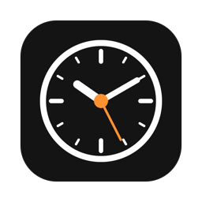
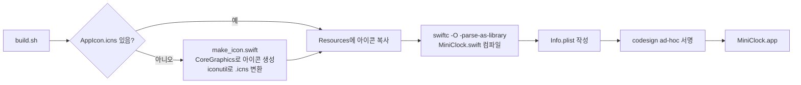

<p align="center">
  
</p>

<h1 align="center">MiniClock</h1>

<p align="center">항상 화면 위에 떠 있는 macOS용 미니 데스크톱 시계</p>

---

검은 창에 큰 글씨로 현재 시각을 표시하고, 그 아래에 한국어 날짜를 보여 줍니다. Xcode 프로젝트 없이 Swift 소스 파일 하나와 셸 스크립트만으로 빌드합니다.

```
3:36:29
2026년 11월 3일, 화요일
```

## 기능

- 12시간제 시각(`h:mm:ss`)을 1초마다 갱신합니다.
- 날짜를 `yyyy년 M월 d일, EEEE` 형식으로 표시합니다.
- 창이 항상 다른 창 위에 떠 있으며(floating), 전체 화면 앱 위에도 표시됩니다.
- 타이틀바를 숨겼으며, 창 배경을 끌어서 위치를 옮길 수 있습니다.
- 창 크기에 비례하여 글자 크기가 조절됩니다.
- 마지막 창을 닫으면 앱이 종료됩니다.

## 요구 사항

- macOS 14 이상
- Swift 컴파일러(`swiftc`): Xcode 또는 Command Line Tools(`xcode-select --install`)

## 빌드와 실행

```bash
git clone git@github.com:ic4r/mini-clock.git
cd mini-clock
./build.sh
open MiniClock.app
```

계속 사용하려면 `/Applications`로 복사합니다.

```bash
cp -R MiniClock.app /Applications/
```

> ad-hoc 서명만 적용되어 있으므로, 다른 Mac으로 옮겨 실행하면 Gatekeeper 경고가 표시될 수 있습니다. 이때는 Finder에서 앱을 우클릭한 뒤 **열기**를 선택합니다.

## 빌드 과정



## 파일 구성

| 파일 | 설명 |
| --- | --- |
| `MiniClock.swift` | 앱 본체(SwiftUI). 시계 화면과 창 설정을 담고 있습니다. |
| `build.sh` | `.app` 번들 생성, `Info.plist` 작성, ad-hoc 서명을 수행합니다. |
| `make_icon.swift` | 시계 모양 아이콘을 그려서 `AppIcon.icns`를 생성합니다. |
| `AppIcon.icns` | 앱 아이콘입니다. |

## 사용자 설정

| 바꿀 항목 | 위치 |
| --- | --- |
| 시각 형식(예: 24시간제 `HH:mm:ss`) | `MiniClock.swift`의 `timeFmt` |
| 날짜 형식 | `MiniClock.swift`의 `dateFmt` |
| 글꼴 | `MiniClock.swift`의 `.custom("Futura-Medium", ...)` |
| 항상 위 해제 | `MiniClock.swift`의 `w.level = .floating` 줄 삭제 |
| 아이콘 | `make_icon.swift` 수정 후 `AppIcon.icns`를 지우고 `./build.sh` 재실행 |

수정한 뒤에는 `./build.sh`를 다시 실행하면 반영됩니다.
